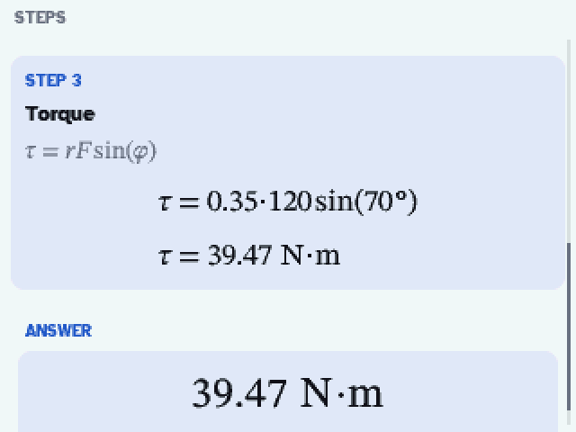
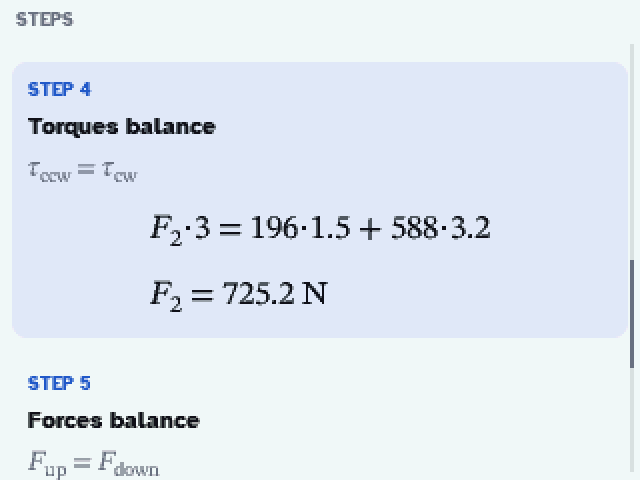
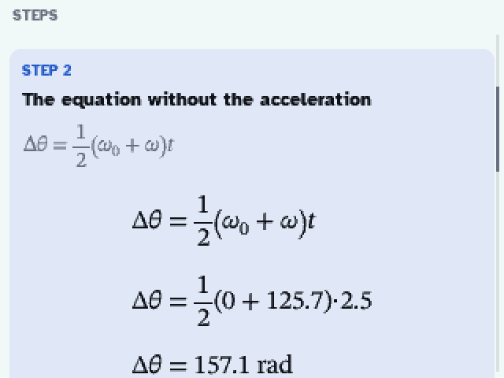
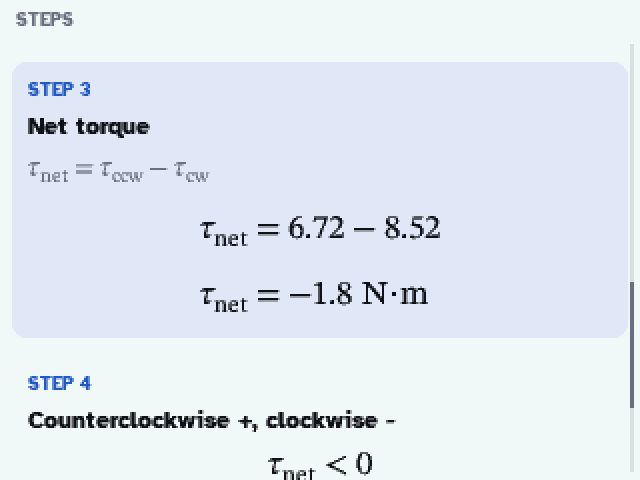
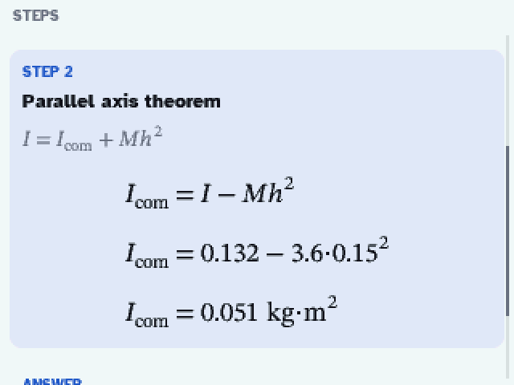
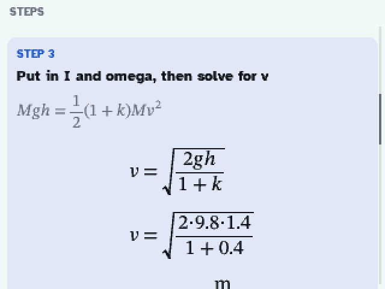
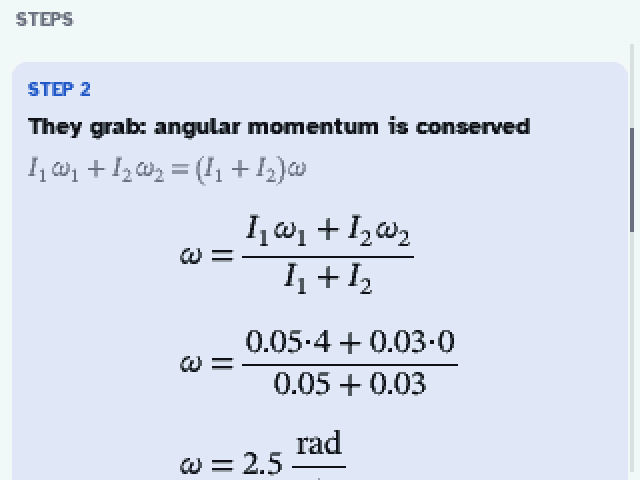
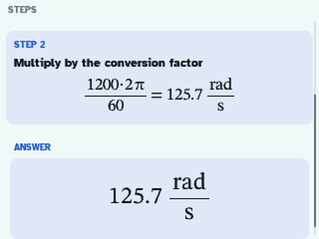
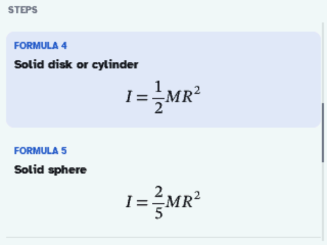

<h1 align="center">Phy CE</h1>

<p align="center">
  <b>Physics on your TI-84 Plus CE.</b><br>
  Fill in what you know. Get the answer with its units, and every step to get there.
</p>

<p align="center">
  <a href="https://nothanro.github.io/PhyCE/"></a>
  <a href="LICENSE"></a>
  
  
</p>

<table>
  <tr>
    <td width="50%"></td>
    <td width="50%"></td>
  </tr>
</table>

Phy CE is [FlowCE](https://github.com/tommyb3ll/FlowCE) made for physics: FlowCE's interface, its
look and its steps' page, with physics problems in place of calculus. It covers rotation, torque,
equilibrium, moment of inertia, rotational energy and angular momentum (PHY110's Chapters 8 and 9).

**[Install from the Phy CE page](https://nothanro.github.io/PhyCE/)**: plug in the calculator,
click Install, and follow the short calculator prompts. **Installing erases the calculator's apps
and archived files**: back them up with TI Connect CE first.

## How it works

`F1` to `F4` open the problem cards: **motion**, **torque**, **inertia**, **energy**. A tile opens
a form: fill in what you know (with a unit if you like: `1200_rpm`, `3_rev`, `30_cm`, `40_deg`;
`(-)` after a number types `_`), leave out what you want, and `enter` on the last field solves it.
After the answer, `enter` shows the steps: each one names its rule, shows the formula, then puts
your numbers in. `F5` (**more**): unit conversions, the formula reference by topic, units, themes.

| Card | Problems |
|---|---|
| motion | angular kinematics (three of Δθ, ω₀, ω, α, t give the other two), a point on a spinning object (v<sub>t</sub>, a<sub>t</sub>, a<sub>c</sub>), period and frequency |
| torque | torque of a force (angle to r or from perpendicular), net torque, center of mass, a beam on two supports, the tipping angle of a box |
| inertia | point masses, the parallel axis theorem, τ = Iα, a hanging mass on a heavy pulley, the Atwood machine with a heavy pulley |
| energy | rotational kinetic energy and a torque's work, rolling down a ramp (I = kMR²), a shape change (I₁ω₁ = I₂ω₂), two disks that grab |

Each problem is also a command for the input line, with named values in any order:
`torque(r=0.35,F=120,phi=40)`, `kinematics(omega0=0,omega=1200_rpm,t=2.5)`,
`beam(s=[1,4],M=20,L=5,m=[60],x=[4.2])`. Lengths in m, masses in kg, angles turned in rad,
angular speeds in rad/s, a force's angle in degrees, unless a unit says otherwise.

<details>
<summary>More screens</summary>

| | | |
|:-:|:-:|:-:|
|  |  |  |
| kinematics | net torque | parallel axis |
|  |  |  |
| a heavy pulley | an Atwood machine | rolling down a ramp |
|  |  |  |
| angular momentum | unit conversion | formula reference |

These are Phy CE's own steps pages, drawn with the app's code on a computer (`tools/hostgiac -V`).

</details>

## Install

From the page: Chrome or Edge, the calculator's USB cable, then **Connect calculator** and **Install**.
With TI Connect CE: download `PhyCE.b84` from the [latest release](https://github.com/nothanro/PhyCE/releases/latest),
clear the archive (`2nd` `+` → `7` → ▶ ARCHIVE → `3` → `2`), send the bundle, then `prgm` →
`enter` → `enter` (arTIfiCE), `enter` (INST), `enter` to install. At "Success! Will now reset",
`enter`, then `apps` → **PhyCE**. Phy CE and FlowCE do not both fit in the calculator's archive.

## Building

The workflow (`.github/workflows/phyce.yml`) builds and publishes everything on each push to `main`.
By hand, on Linux, with the [CE C/C++ toolchain](https://github.com/CE-Programming/toolchain) v15 in
`~/CEdev`, `g++` and `python3`, after cloning with `--recursive` (the engine is the `src/giac` submodule):

```
ln -sf app.src1 app_tools/app.src
APP_NAME=PhyCE APP_INFO="Phy CE - physics - GNU GPL" tools/dev/linux_build_v15.sh "$PWD" "APPLANG=en PHYS=1"
```

`PHYS=1` builds Phy CE: `src/physics.cc` (the problems, their answers and their steps) takes the
place of FlowCE's calculus steps (`src/steps.cc`) behind the same interface. The physics letters
(ω α τ φ Δ °) were added to the math fonts by `tools/fonts/add_math_greek.py`. The steps can be checked
on a computer with the host build of the engine: `EXTRA_DEFS="-DWITH_UNITS -DPHYSCE" tools/hostgiac/build.sh phys`,
then `hostgiac-phys -S -e 'torque(r=0.35,F=120,phi=40)'` (`-V dir`: the steps pages as images).

## Credits and license

Phy CE is a fork of [FlowCE](https://github.com/tommyb3ll/FlowCE) by Tommy Bell, itself a fork of
[KhiCAS](https://www-fourier.univ-grenoble-alpes.fr/~parisse/) by Bernard Parisse. Not affiliated
with FlowCE or Texas Instruments.

- **Math engine:** Giac, by Bernard Parisse and contributors (Institut Fourier, Université
  Grenoble Alpes).
- **Console interface:** adapted from Eigenmath for the Casio Prizm by G. Maia, Mike Smith,
  Nemhardy and LePhenixNoir.
- **Thanks** to Adrien Bertrand, Xavier Andreani and the TI-83/84 development community,
  especially Jacob Young, commandblockguy and Matt Waltz.
- **Installer:** [arTIfiCE](https://yvantt.github.io/arTIfiCE/) by YvanTT.
- **Fonts:** Atkinson Hyperlegible, STIX Two (SIL Open Font License).

Free software under the GNU General Public License, version 3 or later ([LICENSE](LICENSE)), with
no warranty. Phy CE solves problems step by step: follow your class and test rules.
